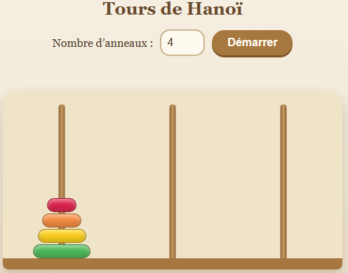
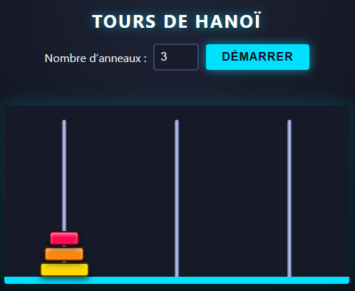

# Le Journal du TP

## Exercice 1

**A/** Le LLM (Claude) a bien respecté la séparation des trois fichiers.

Cependant, il y a des éléments non demandés qui ont été ajoutés :
- Dans index.html : il y a un titre `<h1>`, un `<label for="nb-anneaux">`, une `
` et des balises `<meta>` et `<title>`.
- Dans style.css : tout l'habillage. Nous avons demandé que la structure, mais si elle est sans styles, tout serait invisible et la page ressemblerait à une page blanche.

**B/** Ces noms forment le contrat HTML, le CSS et le JavaScript. Le script cherchera des identifiants non définis ; s'ils changent d'un caractère, tout casse sans erreur claire. Les fixer dès le départ garantit la cohérence entre les étapes suivantes.

## Exercice 2

**A/** L'état du jeu est rangé dans une variable JavaScript (`var etat = [[], [], []];`, trois tableaux représentant les trois piles, avec les tailles d'anneaux), et non dans le DOM : la fonction `rendre()` ne fait que reconstruire l'affichage à partir de cette variable, donc aucune réécriture n'est nécessaire. Cela compte pour la suite, car les règles du jeu, le compteur de coups, la détection de victoire ou un éventuel solveur s'appuieront tous sur ces données fiables, alors que le DOM est détruit et recréé à chaque affichage et ne peut donc pas servir de mémoire.

**B/** Une valeur hors bornes est ramené à la borne la plus proche, lorsqu'on note 0 ça nous renvoie à 1, et pour 12 à 8, une valeur vide renvoie à sa valeur "par défaut" qui est 3. 
En le corrigeant, le LLM a rajouté une fonction `lireNombreAnneaux()` qui liste un message d'erreur. 

## Exercice 3 

**A/** Pour tester `deplacementValide` dans la console, on écrit à la main l'état du jeu puis on appelle la fonction : `etat = [[3, 2, 1], [], []]; deplacementValide(0, 1);` donne `true` (la tour d'arrivée est vide), `etat = [[3, 2], [5, 4], []]` donne `true` (le petit anneau va sur un plus grand) et `etat = [[3, 2], [1], []]` donne `false` (un grand anneau ne peut pas aller sur un plus petit).
On met cette règle dans une fonction à part, et pas dans le clic, parce qu'ainsi on peut la tester facilement sans cliquer, la réutiliser plus tard (indice, résolution automatique, clavier) et la corriger à un seul endroit. 

**B/** Le cas que le LLM (Claude) n'avait pas bien prévu est le clic sur une tour quand aucune partie n'est lancée : comme l'état est vide au chargement, le code répond seulement « Cette tour est vide : rien à sélectionner », ce qui ne dit pas qu'il faut d'abord cliquer sur « Démarrer » (le clic sur un anneau qui n'est pas au sommet était prévu et refusé avec un message, et le double clic ne casse rien puisque le second clic annule simplement la sélection). 

Pour traiter le cas non prévu (clic sur une tour quand aucune partie n'est lancée), nous avons ajoutés une variable `partieEnCours`, à `false` au chargement et passée à `true` dans `demarrer()`, puis un test au début de `gererClic` qui bloque tout clic avec le message « Clique d'abord sur « Démarrer » pour commencer une partie. » tant que le jeu n'a pas démarré.

## Exercice 4 

**A/** Oui, le LLM (Claude) a modifié `script.js` alors que seul le style était demandé : il y a ajouté un tableau `COULEURS` (qui remplace le `hsl()` calculé dans `rendre()`) et une ligne qui ajoute la classe `origine` sur la tour de départ, même si la logique du jeu (`etat`, `selection`, `deplacementValide`, `gererClic`, `demarrer`) est restée identique.

Pour l'en empêcher, il faut ajouter au prompt la contrainte suivante : « Ne modifie que style.css (et index.html si nécessaire), ne touche à aucune ligne de script.js et ne le renvoie pas »

**B/** J'ai demandé qu'il me donne deux propositions de fichiers CSS complets pour modifier le fichier initial avecdes styles diférents. Il a protogé le jeu, c'est à dire qu'il n'a pas modifié `index.html` ni le `script.js`. Ensuite il a forcé unevraie différente entre le style A et  eEn imposant deux directions précises (sobre et chaleureux contre sombre et contrasté). 
J'ai gardé le style A. 

## Exercice 5

**A**
" pour la suite, ajoute à mon jeu un bouton "démo autmatique" qui resout le jeu sous les yeux de l'utilisaeur grace à un algorithme récursif mais pour ça je souhaite que tu réalise deux fonctions distinctes : resoudre(n, de, vers, via) qui renvoie la liste des coups (des couples [de, vers]) sans rien afficher, et une fonction qui rejoue cette liste coup par coup avec un délai (setTimeout, ou async/await avec une fonction d’attente). " 

Oui, le LLM (Claude) connaît l'algorithme car il déplace les n-1 anneaux du dessus vers la tour intermédiaire, puis le plus grand vers la tour d'arrivée, puis les n-1 par dessus, et il est correct, ce quise vérifie dans la console `resoudre(3,0,2,1).length qui vaut 7 (et 31 pour 5 anneaux)

**B** Parce que ce sont deux problèmes différents, et les mélanger rendrait le code plus difficle à tester, à corriger et à faire évoluer. Lorsque le'utilisateur clique sur "Démarrer" pendant la démo, la démo s'arrête immédiatement et le jeu repart d'une partie neuve, jouable par l'utilisateur. 

Le LLM (Claude) a traité ce cas en ajoutant une fonction `annulerDemo` dans le gestionnaire `demarrer()`, qui incrémente un compteur idDemo et remet demoEnCours à false, de sorte que la démo en cours, qui compare son propre numéro à idDemo après chaque attente, constate qu’il est périmé et s’arrête sans plus rien modifier, pendant que demarrer() réinitialise l’état et redessine un plateau neuf avec tous les anneaux sur la première tour.

