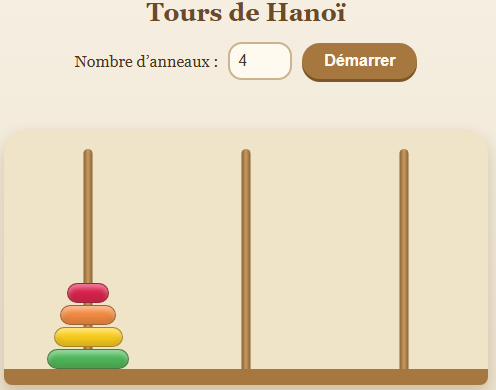
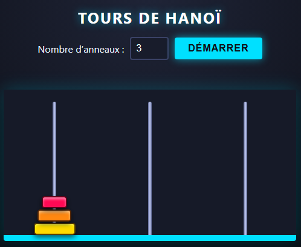
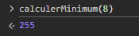

# Le Journal du TP

## Exercice 1

**A/** Le LLM (Claude) a bien respecté la séparation des trois fichiers.

Cependant, il y a des éléments non demandés qui ont été ajoutés :
- Dans index.html : il y a un titre `<h1>`, un `<label for="nb-anneaux">`, une `
` et des balises `<meta>` et `<title>`.
- Dans style.css : tout l'habillage. Nous avons demandé que la structure, mais si elle est sans styles, tout serait invisible et la page ressemblerait à une page blanche.

**B/** Ces noms forment le contrat HTML, le CSS et le JavaScript. Le script cherchera des identifiants non définis ; s'ils changent d'un caractère, tout casse sans erreur claire. Les fixer dès le départ garantit la cohérence entre les étapes suivantes.

## Exercice 2

**A/** L'état du jeu est rangé dans une variable JavaScript (`var etat = [[], [], []];`, trois tableaux représentant les trois piles, avec les tailles d'anneaux), et non dans le DOM : la fonction `rendre()` ne fait que reconstruire l'affichage à partir de cette variable, donc aucune réécriture n'est nécessaire. Cela compte pour la suite, car les règles du jeu, le compteur de coups, la détection de victoire ou un éventuel solveur s'appuieront tous sur ces données fiables, alors que le DOM est détruit et recréé à chaque affichage et ne peut donc pas servir de mémoire.

**B/** Une valeur hors bornes est ramené à la borne la plus proche, lorsqu'on note 0 ça nous renvoie à 1, et pour 12 à 8, une valeur vide renvoie à sa valeur "par défaut" qui est 3. 
En le corrigeant, le LLM a rajouté une fonction `lireNombreAnneaux()` qui liste un message d'erreur. 

## Exercice 3 

**A/** Pour tester `deplacementValide` dans la console, on écrit à la main l'état du jeu puis on appelle la fonction : `etat = [[3, 2, 1], [], []]; deplacementValide(0, 1);` donne `true` (la tour d'arrivée est vide), `etat = [[3, 2], [5, 4], []]` donne `true` (le petit anneau va sur un plus grand) et `etat = [[3, 2], [1], []]` donne `false` (un grand anneau ne peut pas aller sur un plus petit).
On met cette règle dans une fonction à part, et pas dans le clic, parce qu'ainsi on peut la tester facilement sans cliquer, la réutiliser plus tard (indice, résolution automatique, clavier) et la corriger à un seul endroit. 

**B/** Le cas que le LLM (Claude) n'avait pas bien prévu est le clic sur une tour quand aucune partie n'est lancée : comme l'état est vide au chargement, le code répond seulement « Cette tour est vide : rien à sélectionner », ce qui ne dit pas qu'il faut d'abord cliquer sur « Démarrer » (le clic sur un anneau qui n'est pas au sommet était prévu et refusé avec un message, et le double clic ne casse rien puisque le second clic annule simplement la sélection). 

Pour traiter le cas non prévu (clic sur une tour quand aucune partie n'est lancée), nous avons ajoutés une variable `partieEnCours`, à `false` au chargement et passée à `true` dans `demarrer()`, puis un test au début de `gererClic` qui bloque tout clic avec le message « Clique d'abord sur « Démarrer » pour commencer une partie. » tant que le jeu n'a pas démarré.

## Exercice 4 

**A/** Oui, le LLM (Claude) a modifié `script.js` alors que seul le style était demandé : il y a ajouté un tableau `COULEURS` (qui remplace le `hsl()` calculé dans `rendre()`) et une ligne qui ajoute la classe `origine` sur la tour de départ, même si la logique du jeu (`etat`, `selection`, `deplacementValide`, `gererClic`, `demarrer`) est restée identique.

Pour l'en empêcher, il faut ajouter au prompt la contrainte suivante : « Ne modifie que style.css (et index.html si nécessaire), ne touche à aucune ligne de script.js et ne le renvoie pas »

**B/** J'ai demandé qu'il me donne deux propositions de fichiers CSS complets pour modifier le fichier initial avecdes styles diférents. Il a protogé le jeu, c'est à dire qu'il n'a pas modifié `index.html` ni le `script.js`. Ensuite il a forcé unevraie différente entre le style A et  eEn imposant deux directions précises (sobre et chaleureux contre sombre et contrasté). 
J'ai gardé le style A. 

## Exercice 5

**A**
" pour la suite, ajoute à mon jeu un bouton "démo autmatique" qui resout le jeu sous les yeux de l'utilisaeur grace à un algorithme récursif mais pour ça je souhaite que tu réalise deux fonctions distinctes : resoudre(n, de, vers, via) qui renvoie la liste des coups (des couples [de, vers]) sans rien afficher, et une fonction qui rejoue cette liste coup par coup avec un délai (setTimeout, ou async/await avec une fonction d’attente). " 

Oui, le LLM (Claude) connaît l'algorithme car il déplace les n-1 anneaux du dessus vers la tour intermédiaire, puis le plus grand vers la tour d'arrivée, puis les n-1 par dessus, et il est correct, ce quise vérifie dans la console `resoudre(3,0,2,1).length qui vaut 7 (et 31 pour 5 anneaux)

**B** Parce que ce sont deux problèmes différents, et les mélanger rendrait le code plus difficle à tester, à corriger et à faire évoluer. Lorsque le'utilisateur clique sur "Démarrer" pendant la démo, la démo s'arrête immédiatement et le jeu repart d'une partie neuve, jouable par l'utilisateur. 

Le LLM (Claude) a traité ce cas en ajoutant une fonction `annulerDemo` dans le gestionnaire `demarrer()`, qui incrémente un compteur idDemo et remet demoEnCours à false, de sorte que la démo en cours, qui compare son propre numéro à idDemo après chaque attente, constate qu’il est périmé et s’arrête sans plus rien modifier, pendant que demarrer() réinitialise l’état et redessine un plateau neuf avec tous les anneaux sur la première tour.

## Exercice 6 

**A** Calaude a choisi `element.animate()` avec `transform` parce que `rendre()` recrée les anneaux à chaque coup, ce qui rend les transistions CSS inutilisables, et l'alternative aurait été des `@kayframes` CSS pilotés par des variables, plus dispersés et moins pratiques pour attendre la fin du mouvement. 

**B** L’animation a demandé le plus de reformulations, parce qu’elle entrait en conflit avec la règle d’architecture, `rendre()` recrée les anneaux à chaque coup, donc les transitions CSS ne marchent pas.

Ce qui manquait au premier prompt : il ne précisait pas que l’animation devait s’appliquer à des anneaux recréés par `rendre()`, que l’état devait être mis à jour avant l’animation, ni quelle technique utiliser.

**C** En Javascript le LLM écrit `Math.pow(2, n) - 1`.

## Exercice 7 

Le prompt envoyé aux deux LLM différents : 

Tu es un développeur web front-end expérimenté. Tu écris du code lisible, commenté en français, et tu respectes à la lettre les noms et les contraintes qu'on te donne. 

Construis le jeu des Tours de Hanoï en HTML, CSS et JavaScript purs, en trois fichiers ouverts directement dans le navigateur (double-clic sur index.html, sans serveur). L'interface est entièrement en français. Le joueur déplace des anneaux entre trois tours, à la souris, avec la règle : on ne pose jamais un grand anneau sur un plus petit.

1. **Page minimale** : une zone `#plateau` contenant trois éléments de classe `tour` ; un champ numérique `#nb-anneaux` (min 1, max 8, valeur 3) ; un bouton `#btn-demarrer` libellé « Démarrer ».
2. **Création des anneaux** : au clic sur « Démarrer », les anneaux sont créés sur la première tour, empilés, en nombre égal à la valeur du champ, de largeurs décroissantes du bas vers le haut. Un second clic remet le jeu à zéro sans dupliquer les anneaux. Une valeur hors bornes (0, 12, vide, décimale) est corrigée, et un message en français l'explique.
3. **Jeu à la souris** : un clic sélectionne l'anneau du sommet d'une tour (seul le sommet est sélectionnable, il est mis en évidence) ; un second clic sur une tour l'y dépose si la règle le permet. Un dépôt interdit est refusé avec un retour visuel (tour rouge qui tremble) et sans modifier l'état. Une tour vide accepte tout anneau. Un clic sur la tour d'origine annule la sélection. Tant que « Démarrer » n'a pas été cliqué, un clic sur une tour affiche un message invitant à démarrer.
4. **Apparence** : chaque anneau a une couleur distincte ; la sélection est clairement visible ; la page reste lisible sur une fenêtre étroite (moins de 520 px).
5. **Démo automatique** : un bouton `#btn-demo` « Démo automatique » repart d'une partie neuve et résout le jeu sous les yeux du joueur. Les clics sur les tours sont ignorés pendant la démo. Un clic sur « Démarrer » ou « Reset » l'interrompt proprement.
6. **Compléments, dans cet ordre** :
   1. un compteur de coups, incrémenté en mode manuel comme en démo ;
   2. la détection de la victoire (tous les anneaux sur la troisième tour, détectée une seule fois) et un message de félicitations ;
   3. un score fondé sur le nombre minimal de coups 2ⁿ − 1 (rapport minimum / coups joués, en pourcentage), affiché en fin de partie ;
   4. un bouton « Reset » qui remet compteur, score, sélection et affichage à zéro, y compris pendant une démo ;
   5. des animations avancées : l'anneau se soulève, glisse au-dessus des tours puis redescend, au lieu de réapparaître ;
   6. un mode sombre / clair avec un bouton pour basculer, appliqué à toute la page et conservé après un « Reset ».

- HTML, CSS et JavaScript purs : aucune bibliothèque, aucun framework, pas de modules ES.
- Trois fichiers séparés : `index.html`, `style.css`, `script.js`. Aucun CSS ni JavaScript dans le HTML (ni `<style>`, ni `style=""` écrit à la main, ni `onclick`).
- Identifiants et classes imposés (à reprendre exactement) : `#plateau`, `.tour`, `#nb-anneaux`, `#btn-demarrer`, `#btn-demo`, `#btn-reset`, `#btn-theme`, `.anneau`, `.selectionne`, `.refus`.
- Les tailles des anneaux ne sont jamais codées en dur dans le HTML.
- Le thème passe par des variables CSS.
- La console du navigateur doit rester vide, sans erreur ni avertissement.
- Respecter `prefers-reduced-motion` (animations désactivées si demandé).

- **L'état du jeu est une structure JavaScript** : un tableau de trois tableaux de tailles d'anneaux (le bas de la pile est à l'indice 0), plus quelques variables (sélection, nombre de coups, partie en cours). **Le DOM n'est jamais la source de vérité.**
- Une fonction `rendre()` reconstruit tout l'affichage à partir de cet état. Rien n'est lu dans le DOM pour décider d'un coup.
- La règle est isolée dans `deplacementValide(de, vers)`, qui ne touche pas au DOM.
- Le calcul de la solution est séparé de son exécution :
  - `resoudre(n, de, vers, via)` est récursive, renvoie la liste des coups sous forme de couples `[de, vers]`, et n'affiche rien, ne lit ni ne modifie l'état ;
  - une fonction distincte rejoue cette liste coup par coup avec un délai (`async/await` avec une fonction d'attente, ou `setTimeout`).
- `resoudre(3, 0, 2, 1).length` doit valoir 7 et `resoudre(5, 0, 2, 1).length` doit valoir 31.
- Les coups de la démo passent par la même logique que ceux du joueur (état, compteur, `rendre()`).
- Les animations sont purement visuelles : l'état est mis à jour avant, et les clics sont ignorés pendant leur déroulement.
- Chaque nouvelle partie ou démo annule proprement la précédente (par exemple avec un compteur d'identifiant de démo), pour qu'aucune animation en retard ne modifie la partie suivante.

- Donne le contenu **complet** des trois fichiers `index.html`, `style.css` et `script.js`, chacun dans son propre bloc de code, précédé de son nom en gras.
- Pas d'explication avant les fichiers.
- Après les fichiers, ajoute au maximum 10 lignes : les choix techniques importants (en particulier la technique d'animation retenue et pourquoi) et les limites éventuelles.
- Si une exigence te paraît ambiguë ou impossible à respecter avec ces contraintes, dis-le après les fichiers plutôt que de la contourner en silence.

| Critère | ChatGPT | Gemini |
|---|---|---|
| Fonctionnalités correctes du premier coup (sur 6) | à compléter après tes tests | à compléter après tes tests |
| Nombre de reformulations nécessaires | à compléter | à compléter |
| Taille du code (lignes) | 649 (script.js), 440 (style.css), 80 (index.html) | 256 (script.js), 209 (style.css), 43 (index.html) |
| Noms et signatures imposés | tous respectés | respectés, sauf `deplacementValide` qui a un 3e paramètre |
| État séparé de l'affichage (`rendre()`) | oui | oui |
| `resoudre` correcte (7 coups pour 3 anneaux) | oui | non : la liste est tronquée (3 coups) |
| `resoudre` séparée de l'animation | oui | oui |
| Démo automatique | probablement fonctionnelle (à tester) | ne joue rien : l'identifiant de démo est incrémenté deux fois |
| Clics ignorés pendant la démo | oui | non : possibles entre deux coups |
| État mis à jour avant l'animation | oui | non : mis à jour après |
| Technique d'animation | `element.animate()` sur un anneau temporaire | `setTimeout` imbriqués et `transform` en ligne |
| Score affiché séparément | oui | non : seulement dans le message de victoire |
| Mode sombre conservé après Reset | oui | oui |
| Lisibilité | très commenté, découpé en sections | court, peu de commentaires |

**A** Une fois l'architecture imposé retiré, au niveau visuel rien n'a chngé mais pour ChatGPT le code adopte une approche impérative orientée DOM, tout en conservant un état centralisé en JavaScript. Pour Gemini, le code passe d'un état centralisé en mémoire à une manipulation directe des éléments du DOM.

**B** Le code obtenu en un seul prompt est comparable à celui des six exercices avec ChatGPT et moins bon avec Gemini.
Sur trois critères : 
- Ce qu'on attend de lui sur le `resoudre` et de la démo (7 coups pour 3 anneaux),
- Le respect de l’architecture imposée (la mémoire du jeu d’un côté, l’affichage de l’autre, et la mémoire modifiée avant d’animer),
- Les LLM ont bien programmé tout ce que j'avais demandé dans la liste
